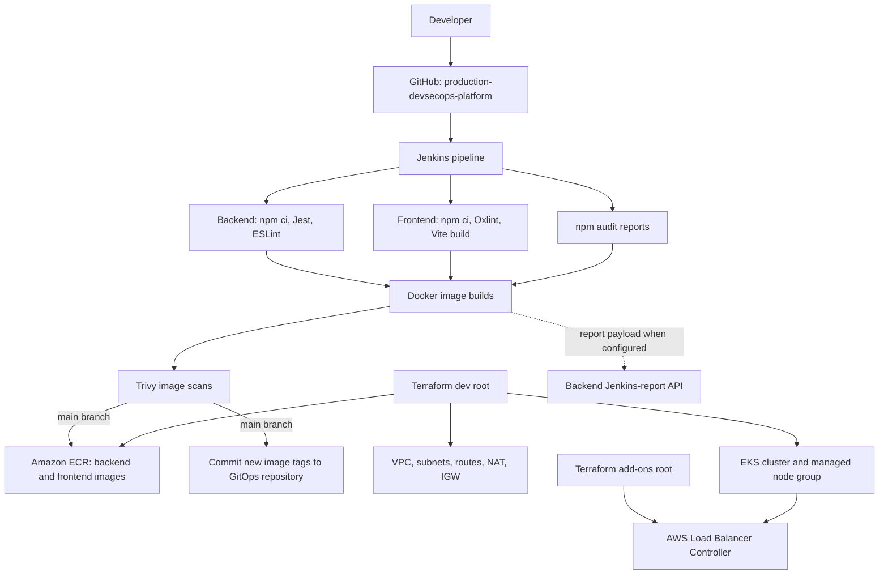

# Platform repository architecture

This repository contains the application, Jenkins pipeline, container build files, Terraform infrastructure definitions, and the Helm chart used to package the workload. The Argo CD application source and deployment values live in the separate GitOps repository.

## Responsibilities

- **Application code:** `backend/`, `frontend/`, and `docker-compose.yml`.
- **CI and security checks:** `Jenkinsfile` runs backend tests/lint, frontend lint/build, npm audit report generation, Docker builds, and Trivy image scans.
- **Artifact publication:** the `main` branch path publishes images to ECR and updates the GitOps values file.
- **Cloud infrastructure:** `terraform/envs/dev` creates the network, EKS, ECR, and related IAM resources.
- **Cluster add-on:** `terraform/envs/addons` installs the AWS Load Balancer Controller into an existing EKS cluster.
- **Workload chart:** `helm/production-devsecops-platform` packages the app services; Argo CD consumes the deployment chart from the GitOps repository.

Monitoring was installed separately using the Prometheus community `kube-prometheus-stack` Helm chart in a `monitoring` namespace; that release is not defined in this repository's Terraform roots or the GitOps app chart.
