# End-to-end project architecture

This diagram combines the application/CI repository, GitOps repository, AWS runtime, and separately installed monitoring stack. It reflects the configured flow in the supplied files and the deployment that was exercised before teardown.

```mermaid
flowchart LR
  Dev[Developer] -->|push source| AppRepo[GitHub application repo]
  AppRepo -->|checkout| Jenkins[Jenkins CI]
  subgraph CI[Build and security]
    Jenkins --> B[Backend tests and lint]
    Jenkins --> F[Frontend lint and build]
    Jenkins --> A[npm audit reports]
    B --> Docker[Build backend/frontend images]
    F --> Docker
    A --> Docker
    Docker --> Trivy[Trivy image scans]
  end
  Trivy -->|main branch only| ECR[Amazon ECR]
  Trivy -->|main branch only| GitCommit[Update image tags]
  GitCommit --> GitOpsRepo[GitHub GitOps repo]
  GitOpsRepo --> Argo[Argo CD Application]
  Argo --> Helm[Helm chart reconciliation]
  subgraph AWS[AWS runtime when provisioned]
    ECR -->|image pull| EKS[EKS cluster]
    Helm --> EKS
    ALB[Application Load Balancer] --> Frontend[Frontend Service / Pod]
    Frontend --> Backend[Backend Service / Pod]
    Backend --> Mongo[MongoDB Service / Pod + PVC]
    Backend --> Redis[Redis Service / Pod + PVC]
    EKS --- ALB
  end
  subgraph Observability[Separate monitoring release]
    Prom[Prometheus] --> Grafana[Grafana dashboards]
    NodeExp[node-exporter] --> Prom
    KSM[kube-state-metrics] --> Prom
    EKS -. cluster and workload metrics .-> Prom
  end
```

## Delivery sequence

1. A change is pushed to the application repository.
2. Jenkins runs checks and builds the two images. Trivy scans both images.
3. On `main`, Jenkins pushes images to ECR and commits their tag into `values-ecr.yaml` in the GitOps repository.
4. Argo CD watches the GitOps source and reconciles the chart to the target namespace.
5. Kubernetes schedules frontend, backend, MongoDB, and Redis workloads. The ALB Ingress exposes the frontend when the AWS Load Balancer Controller is present.
6. The separate Prometheus/Grafana release reads node and Kubernetes workload metrics for dashboards.

## Operational boundary

- Terraform provisions AWS infrastructure; Helm/Argo CD deploy application workloads.
- The monitoring stack was installed as a separate Helm release, not as part of the app chart.
- AWS resources have been torn down after evidence capture. This is an architecture of the completed deployment and its reproducible configuration, not a claim that the live endpoint is still active.
